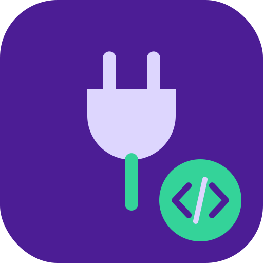

# php-sockets

<p align="center">
  
</p>

Examples of network programming with the PHP sockets extension.

## Contents

- `server.php` and `client.php`: a simple socket server and client.
- `portscan.php` and `simple-portscan.php`: TCP port scanners.
- `service-by-port.php`: looks up the service name for a port.
- `socket-irc-connect.php`: connects to an IRC server.
- An example that sends an HTTP `HEAD` request with a connection timeout.

## Tech

- PHP with the `sockets` extension

## Running

Run a script with the PHP CLI, for example:

```sh
php client.php
```

## License

Licensed under the Apache License 2.0. See [LICENSE](LICENSE).
